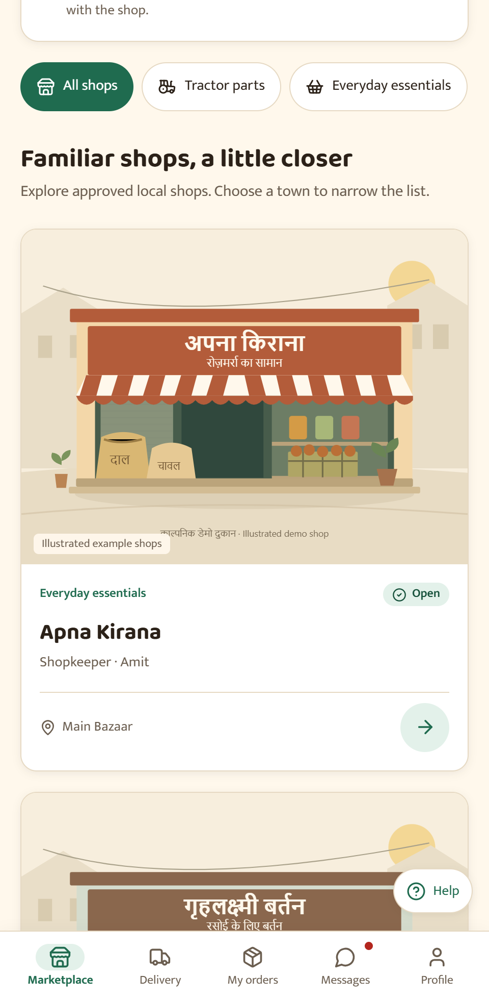
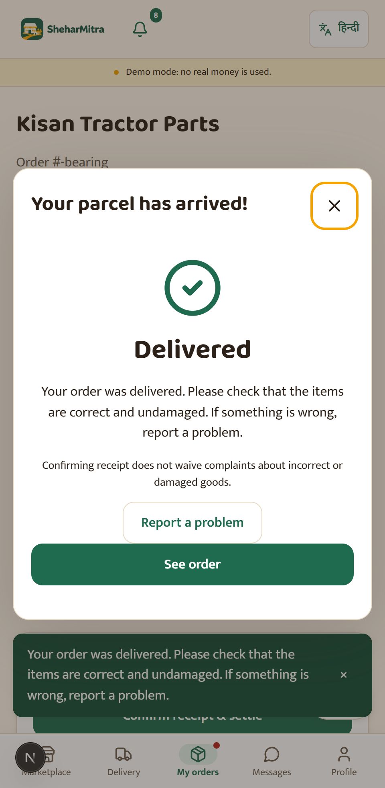

<p align="center">
  
</p>

# शहर मित्र · SheharMitra

**शहर की दुकान, अब आपके गाँव।**

Town shops, now accessible from your village.

[Open the app](https://shehar-mitra-7tcq.vercel.app/en) · [Illustrated walkthrough](output/pdf/SheharMitra-Project-Walkthrough.pdf) · [Read in Hindi](https://shehar-mitra-7tcq.vercel.app/hi)

## Why I built this

Sometimes the item someone needs is available in a nearby town, but getting it means making a separate trip. It might be a tractor part, stationery, groceries, or something from a local hardware shop. At the same time, another person may already be travelling from that town to their village.

I built **SheharMitra** around a simple question: can that existing journey help someone get what they need?

The app connects three people: a buyer, a local shopkeeper, and a delivery partner travelling along a suitable route. I started with the town-and-village context around Najibabad, Nagina, and nearby villages. Addresses are entered by users; the app is not restricted to a fixed list of demo villages.

## A small example

Imagine Seema needs a tractor bearing from a town shop. She finds the shop, messages the owner, and confirms the part over a call. The shopkeeper sends an itemised quote. After accepting it, Seema looks for someone travelling toward her village and agrees on a delivery fee.

The shopkeeper packs the item. A pickup code records the handover to the delivery partner, and a separate delivery code records the handover to Seema. Everyone can see the order's progress, and the buyer gets a clear delivery confirmation.

That is the journey I wanted to bring into one place: **find a shop → discuss the item → agree on the price → arrange delivery → confirm the handover.**

> **Hackathon version:** payments are simulated. The app demonstrates funding, refunds, and settlement through a demo ledger; it does not collect or transfer real money. A real payment gateway is planned after the hackathon.

## What each person can do

| Role | What the app helps them do |
| --- | --- |
| **Buyer** | Find shops, chat or call, request and accept quotes, find a delivery partner, agree on fees, and follow an order through delivery. |
| **Shopkeeper** | Create a shop profile for review, describe available items, respond to buyers, send quotes, and record packing and pickup. |
| **Delivery partner** | Submit details for review, publish upcoming trips, discuss parcel space and meeting points, respond to delivery offers, and confirm handovers. |
| **Admin** | Review shops and delivery-partner applications, inspect orders and users, and assign disputes. |
| **Dispute resolver** | Review an assigned case, its messages and order history, then record a reasoned decision. |

One account can be a buyer, shopkeeper, and delivery partner. Conversations stay between the same two people even when their buying and selling roles change.

## A look inside

<p align="center">
  
  &nbsp;
  
</p>

*Screenshots use synthetic local walkthrough data. The [PDF](output/pdf/SheharMitra-Project-Walkthrough.pdf) follows the full journey and includes the staff screens.*

## The details I focused on

- **Hindi and English:** a mobile-friendly interface with language switching and clear actions.
- **Direct conversations:** private chat and WebRTC audio/video calls, so people can confirm an item before ordering.
- **Clear agreements:** itemised quotes, explicit acceptance, and delivery-fee negotiation before confirmation.
- **Village addresses:** PIN code, town/village, locality, and location information support route matching. Where only an area match is available, people still confirm the exact meeting point by chat or call.
- **Visible progress:** order stages, in-app notifications, separate pickup and delivery codes, and a prominent delivery confirmation.
- **Human review:** shop and delivery-partner review, private document access, and an assigned dispute-resolution workflow.

## Technologies I used

| Part | Technology and purpose |
| --- | --- |
| Frontend | **Next.js, React, TypeScript, Tailwind CSS** for pages, interactive controls, and the responsive interface. |
| Backend | **Node.js, Express, TypeScript** for authentication, permissions, orders, matching, and business rules. |
| Database | **MongoDB with Mongoose** for hosted data; a local JSON adapter for isolated development and demonstrations. |
| Authentication | **Firebase Authentication** for phone OTP, with backend sessions and phone/password login. |
| Images and documents | **AWS S3** for uploaded files, with access checks for private documents. |
| Chat and calls | **Socket.IO** for realtime events and signaling; **WebRTC** for media; **Cloudflare TURN** for relay connectivity. |
| Addresses | **Geoapify** for configured address lookup, with address-based matching when precise coordinates are unavailable. |
| Notifications | In-app notifications and **Firebase Cloud Messaging** for supported browsers when configured. |
| Deployment | **Vercel** for the frontend and a **Dockerised backend on Northflank**. |

The frontend and backend are separate workspaces in this repository. The backend owns permission checks and order transitions; the browser does not decide whether a handover or payment event is valid.

## Run it locally

Use **Node.js 22 or later**. From a fresh checkout:

```sh
npm ci
```

Copy `backend/.env.example` to `backend/.env` and `frontend/.env.example` to `frontend/.env.local`. Keep existing environment files if you already have them.

For a local demonstration, keep the backend's `DATABASE_ADAPTER=local`, `STORAGE_ADAPTER=local`, and `OTP_PROVIDER=demo`. In the frontend, set `NEXT_PUBLIC_AUTH_PROVIDER=demo` and `NEXT_PUBLIC_DEMO_MODE=true`.

```sh
npm run seed
npm run dev
```

Open [localhost:3000/en](http://localhost:3000/en). **Seeding replaces the selected development database**, so use only disposable local data. Do not seed the hosted database. Real SMS and cross-network calls require their service configuration.

The [local walkthrough](docs/WALKTHROUGH.md) and [setup guide](docs/SETUP.md) contain the demo flow and setup details. Synthetic local accounts use phone numbers `9000000001` through `9000000008` and the default password `DemoPass123!` unless `DEMO_PASSWORD` was changed. The first five accounts are buyer, seller, delivery partner, admin, and resolver respectively. These are local seed accounts, not credentials for the public app.

## Project structure

```text
frontend/        Next.js app, role workspaces, translations, and interface
backend/         Express API, data adapters, order rules, and realtime services
docs/            Setup, deployment, and project documentation
output/pdf/      Illustrated project walkthrough
Dockerfile.backend
```

Useful checks:

```sh
npm run typecheck
npm test
npm run lint
npm run build
```

For hosting, see [Northflank and Vercel deployment](docs/DEPLOYMENT.md), [live service setup](docs/LIVE-SETUP.md), and the [environment reference](docs/ENVIRONMENT.md). Credentials belong in local environment files or the hosting platforms' environment settings.

## What comes next

My next step is integrating real payments, followed by more field testing with local users. I also want to improve address suggestions and learn where people need clearer guidance during ordering and delivery.

This is a hackathon pilot. Route matches help people find a possible delivery partner; they are not a guarantee of road coverage or available parcel space. The current realtime deployment uses one backend instance, and broader rollout will need further operational work and testing.

Built by **Abhinav Chauhan**.
